# Logic Puzzles

[](https://github.com/acroca/pwagames/actions/workflows/deploy.yml)
[](LICENSE)

**[▶ Play at acroca.com/pwagames](https://acroca.com/pwagames/)**

A free, open-source Progressive Web App with seventeen logic puzzle games, designed for phones.
No ads, no accounts, works offline.

Every puzzle is generated on the fly, has exactly one solution, and can be solved by logic
alone — no guessing needed.

<p align="center">
  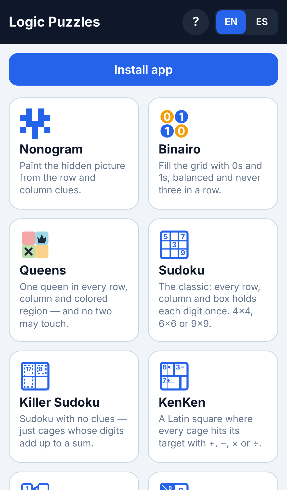
</p>

## Install

Open the link above on your phone and tap **Install app**, or:

- **iPhone / iPad**: in Safari, **Share → Add to Home Screen**.
- **Android**: in the browser menu (⋮), **Install app** or **Add to Home screen**.

It then runs full-screen and works offline.

## Games

### Nonogram

Paint the hidden picture. The numbers beside each row and column give the lengths of its runs of filled cells, in order, with at least one empty cell between runs.

**Sizes:** 10×10

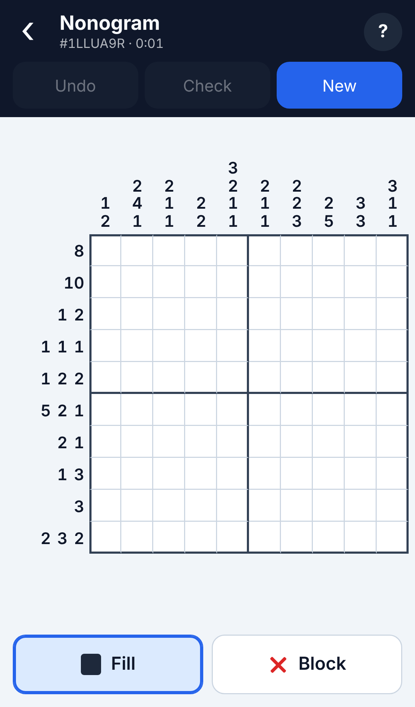

### Binairo (Takuzu)

Fill the grid with 0s and 1s. Every row and column holds as many 0s as 1s, never three of the same digit in a row, and no two rows or two columns are identical.

**Sizes:** 6×6, 8×8, 10×10

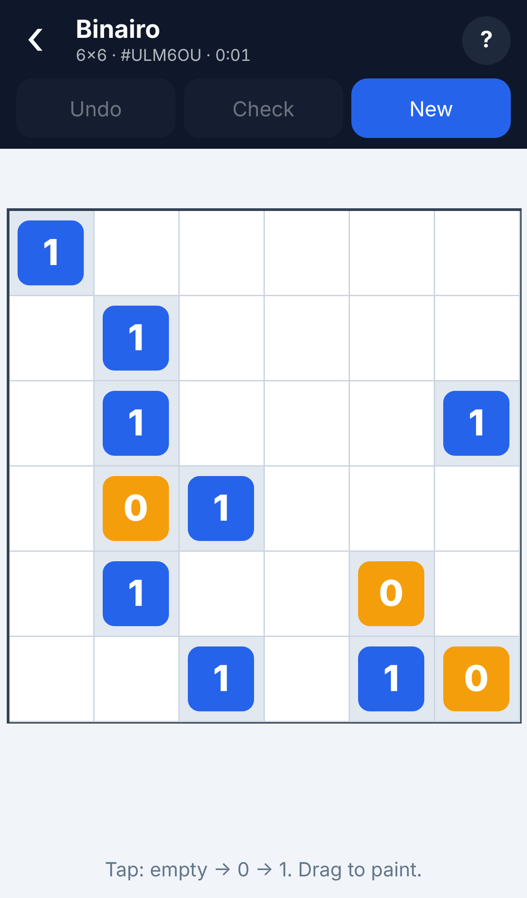

### Queens (Star Battle)

Place one queen in every row, every column and every colored region. No two queens may touch, not even diagonally.

**Sizes:** 7×7 – 10×10

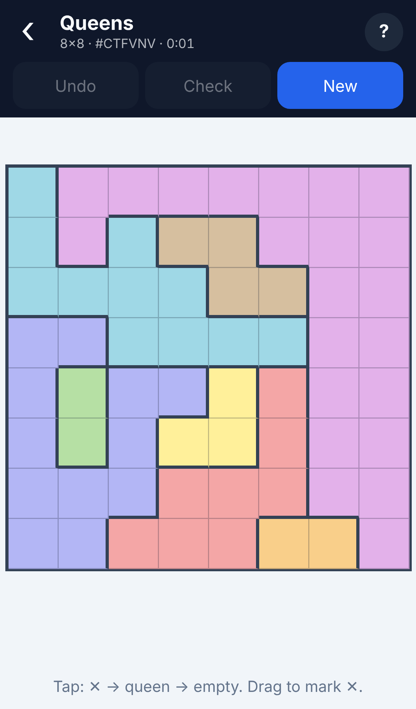

### Sudoku

The classic: every row, column and box holds each digit exactly once.

**Sizes:** 4×4, 6×6, 9×9 (easy, medium, hard)

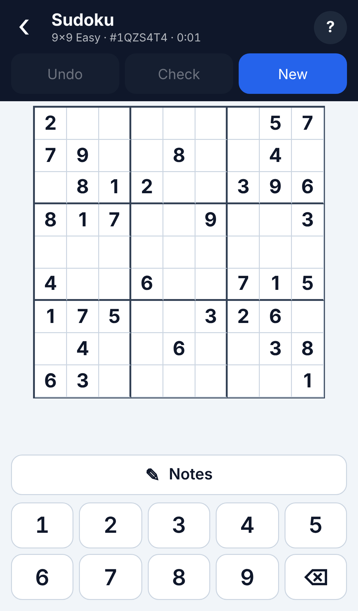

### Killer Sudoku

Sudoku with cages instead of clues: the digits in each dashed cage add up to its sum, and no digit repeats inside a cage.

**Sizes:** Easy, medium, hard

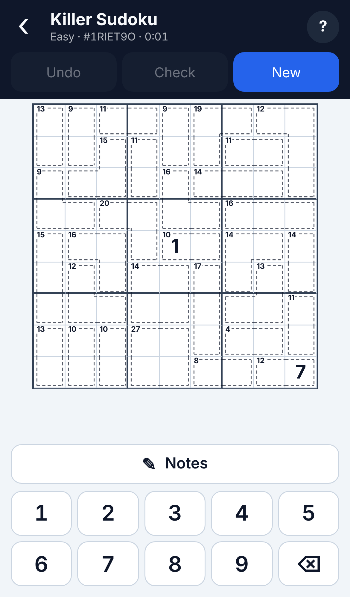

### KenKen

Fill a Latin square (each digit once per row and column) so that every cage reaches its target using its operation: +, −, × or ÷.

**Sizes:** 4×4, 5×5, 6×6

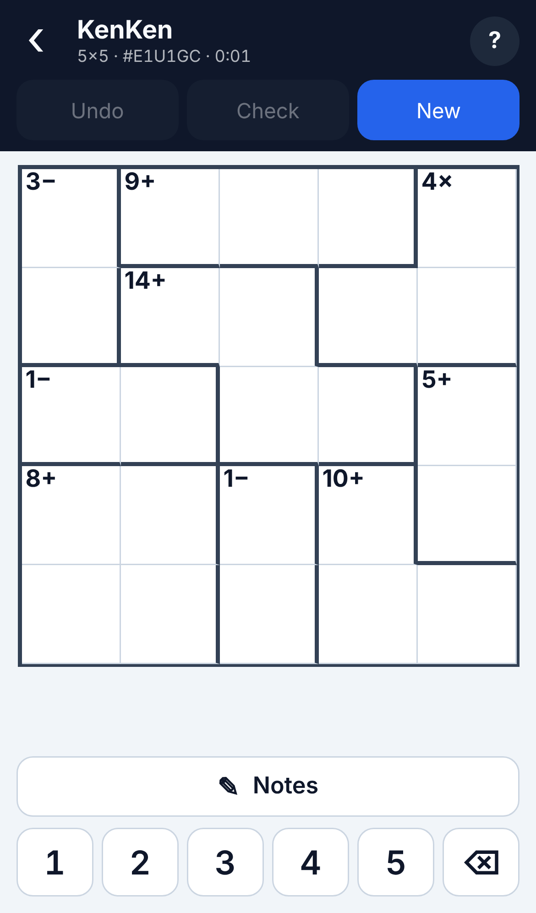

### Futoshiki

Fill a Latin square while obeying the greater-than and less-than signs between neighbouring cells.

**Sizes:** 5×5, 6×6

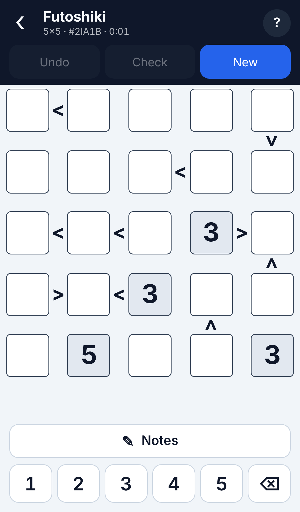

### Skyscrapers

Fill a Latin square with building heights. Each clue on the edge says how many buildings are visible from that side, since taller buildings hide shorter ones.

**Sizes:** 4×4, 5×5, 6×6

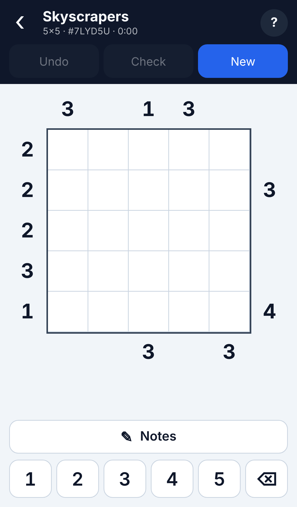

### Kakuro

A crossword of sums: each run of white cells adds up to the clue at its start, using the digits 1–9 without repeating one inside a run.

**Sizes:** 6×6, 8×8 (including clue cells)

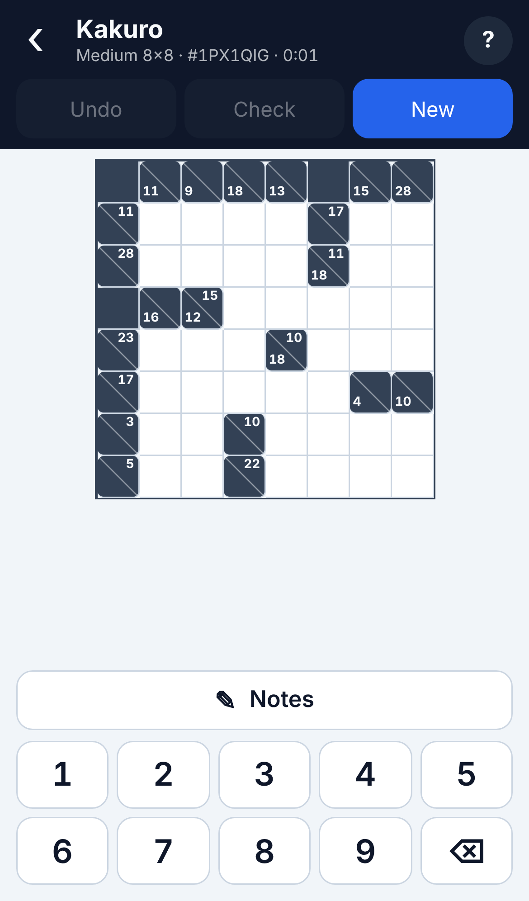

### Hitori

Shade cells so that no number repeats in any row or column. Shaded cells may not touch side by side, and the unshaded cells must stay connected.

**Sizes:** 6×6, 7×7, 8×8

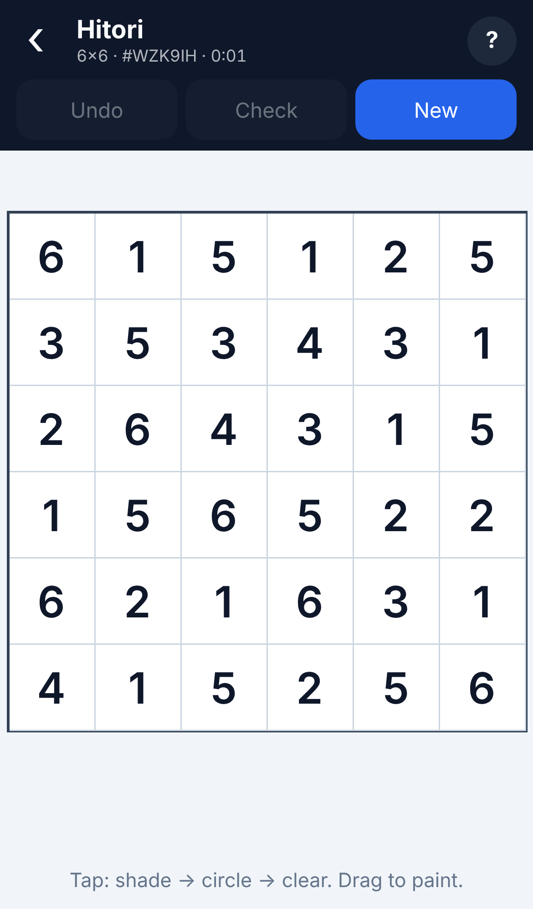

### Nurikabe

Flood the grid with sea, leaving islands. Each island contains exactly one number and has that many cells; the sea is one connected area with no 2×2 pools.

**Sizes:** 7×7 – 10×10

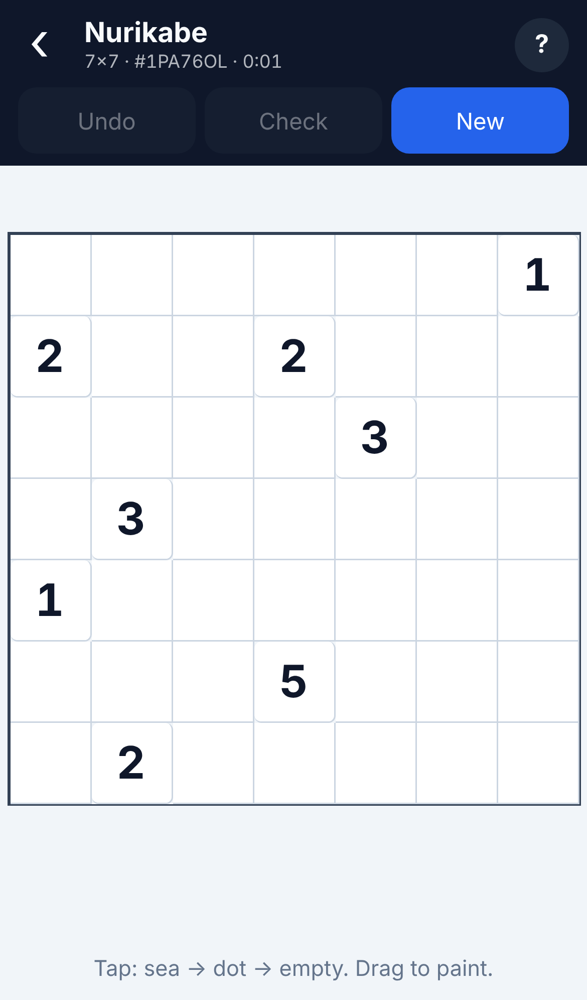

### Slitherlink

Draw a single closed loop along the grid lines. Each number says how many of the four sides of its cell are part of the loop.

**Sizes:** 5×5, 6×6, 7×7

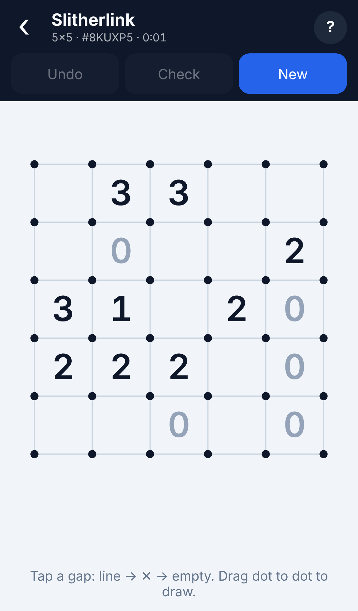

### Minesweeper (no guessing)

Clear the field without hitting a mine: each number counts the mines in the eight surrounding cells. Every board can be finished by logic alone, with no forced guesses.

**Sizes:** 9×9, 9×16

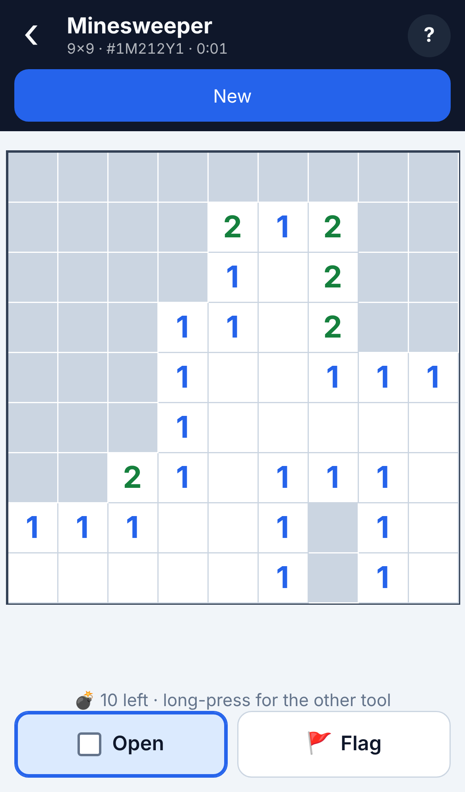

### Tents

Pitch one tent next to every tree, matched one to one. Tents never touch each other, not even diagonally, and the numbers give the tents in each row and column.

**Sizes:** 6×6, 8×8, 10×10

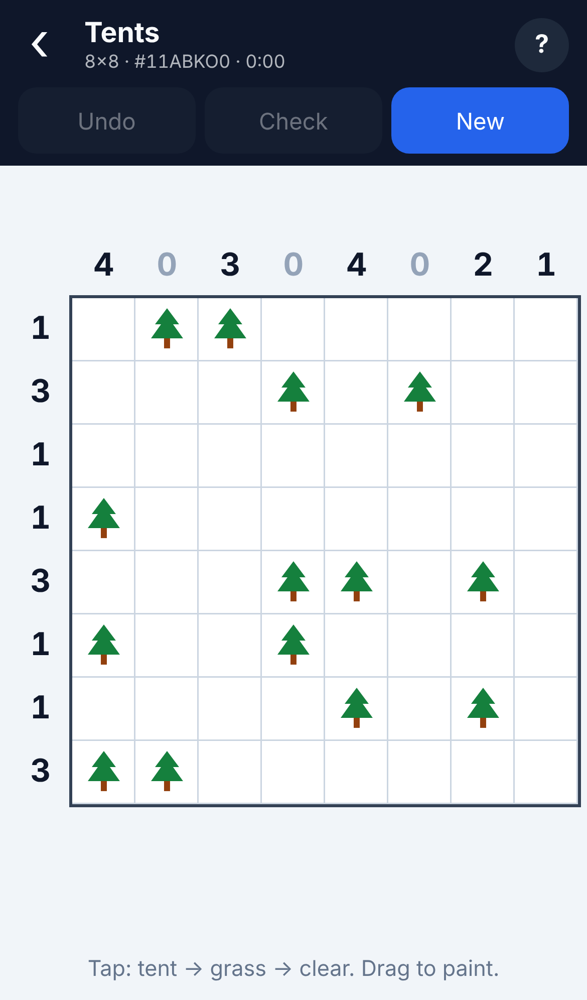

### Light Up (Akari)

Place bulbs so every white cell is lit. A bulb shines along its row and column until a wall, bulbs never light each other, and a number on a wall says how many bulbs touch it.

**Sizes:** 6×6, 8×8, 10×10

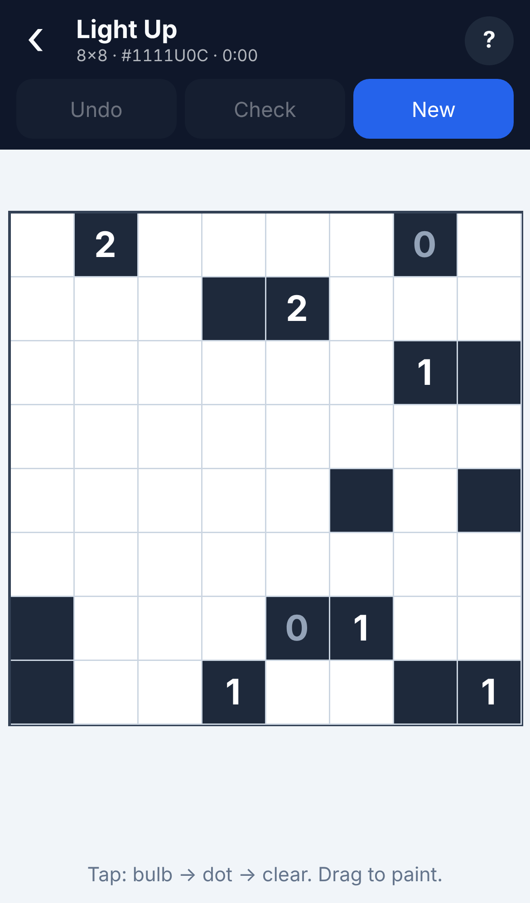

### Bridges

Join the numbered islands with straight bridges, one or two per pair. Each island has as many bridges as its number, bridges never cross, and all islands end up connected.

**Sizes:** 7×7, 9×9, 11×11

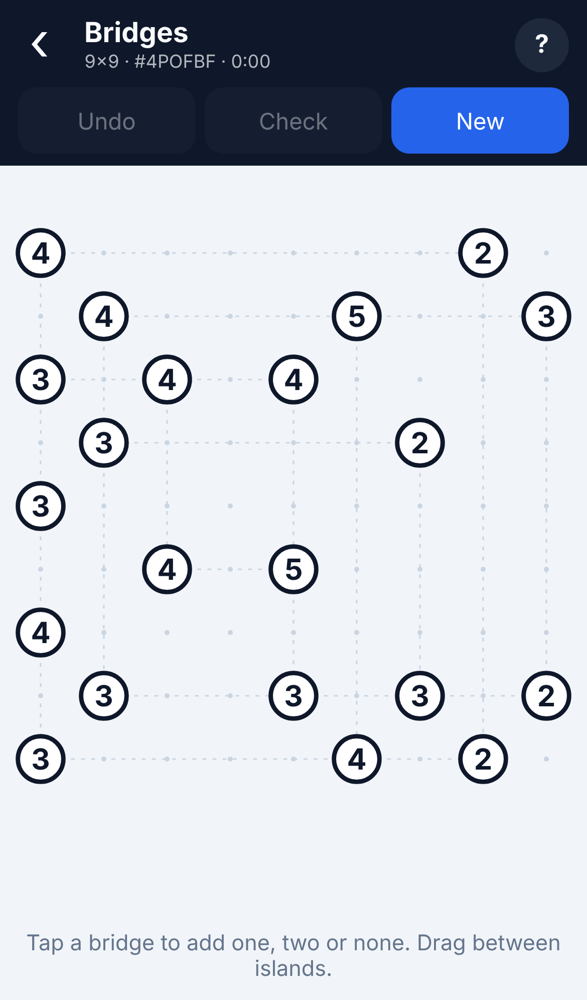

### Battleships

Find the hidden fleet. The numbers give how many ship cells each row and column holds, a few cells are revealed, and ships never touch, not even diagonally.

**Sizes:** 6×6, 8×8, 10×10

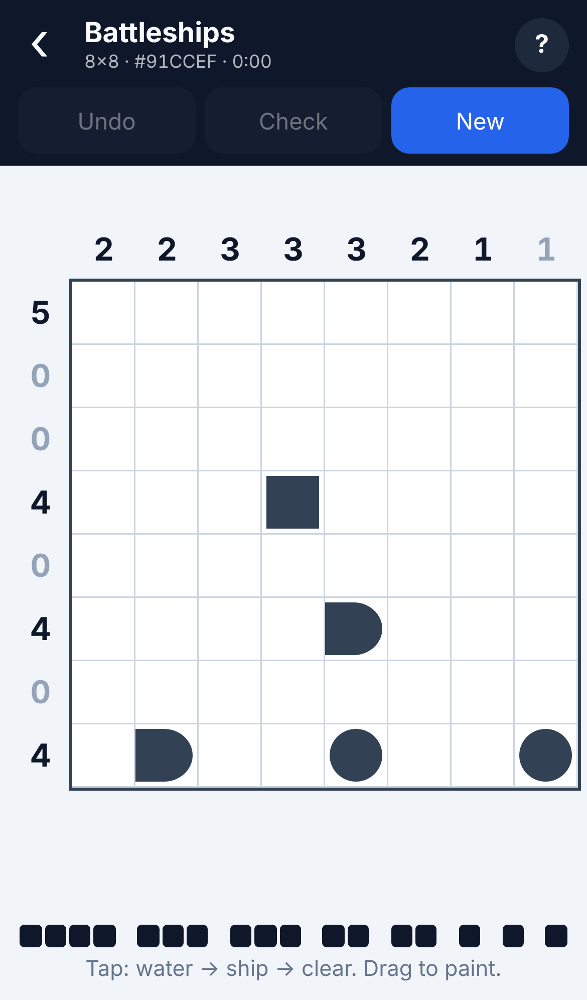

## Shared features

Every game has the same app bar and behaviour:

- **Menu cards** list the games, with the in-progress puzzle or your best time.
- **Undo** steps back through your moves; **Check** flags entries that contradict the
  solution. (Minesweeper has neither: opening a mine ends the game, with an option to retry
  the same board.)
- A **timer** runs while the game is on screen and stops when it's solved; best times are kept
  per game and size.
- Progress is **saved automatically** (per game), so you can switch games and come back.
- **English and Spanish**: the language follows the phone's language by default; switch it with
  the EN / ES selector on the menu. Translations live in `src/core/es.ts` and `src/core/guides.ts`.
- **Rules**: the menu's Rules button (and *How to play* in each game's sheet) explains every game
  with examples.
- **New** opens a sheet to pick a size or difficulty, start a new puzzle, restart the current
  one, change game settings, and read the rules.

## Puzzle generation

Generators live next to each game in `src/games/<game>/logic.ts` and are pure functions of a
size/difficulty and a seed. They run in a Web Worker (`src/core/worker.ts`) with a loading
indicator, so the UI never freezes.

Each generator pairs a *logic solver* (constraint propagation using human techniques only)
with a *counting solver* (propagation + backtracking that stops after finding two solutions).
A puzzle is only accepted if the logic solver solves it completely, which proves its solution
is unique and reachable without guessing. Tests check every generated puzzle with the counting
solver and an independent rule checker.

- **Nonogram**: random pictures are kept only if a line solver fully solves them.
- **Binairo**: givens are removed from a random valid grid while a line solver (no triples,
  balance, unique lines) can still solve it, down to about 30% of the cells.
- **Queens**: regions are grown around a random queen placement, then reshaped by hill-climbing
  until a solver using singles, region/line confinement and one-step lookahead solves it;
  puzzles that need only singles are rejected as too easy.
- **Sudoku**: clues are removed from a random grid while the solution stays unique and a human-
  style solver still finishes it at the chosen level: singles (easy); locked candidates and
  pairs (medium, singles alone must fail); triples, X-Wing, Swordfish and XY-Wing (hard,
  medium techniques must fail).
- **Killer Sudoku**: cages are grown over a random grid, then split (or, on easy, given a
  digit) wherever the solver gets stuck. Levels add cage combinations, the rule of 45 over
  houses and groups of houses, and innie/outie differences; medium and hard have no givens.
- **KenKen**: random cages over a random Latin square, with operations re-picked (then cages
  redrawn) until a solver using cage enumeration, cage-confined digits and naked/hidden
  subsets solves it; puzzles that fall to cage arithmetic plus singles are rejected.
- **Futoshiki**: signs and a few givens are drawn from a random Latin square and thinned while
  a solver using inequality chains, singles and subsets still solves it.
- **Kakuro**: a symmetric layout of runs is filled with random digits; runs the solver can't
  crack are refilled with low/high digits (fewer combinations) until per-run combination
  logic solves the whole grid.
- **Hitori**: a random connected, non-touching shading is laid over a random Latin square and
  each shaded cell copies a number from its row or column; layouts are re-rolled until a solver
  using sandwich/pair patterns, shade/unshade propagation and connectivity (cut cells) solves it.
- **Nurikabe**: islands are grown on an all-sea grid (no 2×2 pools, connected sea), then a
  local search flips cells or moves numbers near whatever the solver can't decide, until a solver
  using reachability, sea/island bottlenecks, pool rules and per-island completions solves it.
- **Slitherlink**: the loop is the outline of a random hole-free region; clues are removed in
  random order while a solver using cell counts, dot degrees, no premature loops, inside/outside
  colouring and 2×2 block enumeration still solves it.
- **Minesweeper**: mines are placed after your first tap, outside its 3×3 area; while a
  simulated player using single/pair rules, frontier enumeration and the mine count gets stuck,
  a mine is moved off the stuck frontier (or the layout is redrawn).
- **Tents**: non-touching tents are placed first, each with a tree beside it, and the row/column
  counts are read off; layouts are re-rolled until a solver using counts, tree adjacency, tent
  exclusion and "common neighbour of a tree's candidates" reasoning solves them.
- **Light Up**: random walls, then bulbs are dropped on any cell nothing lights yet (so none sees
  another) and every wall is numbered; numbers are thinned in random order while a solver using
  wall counts, "someone must light every cell" and one-bulb-per-run still solves the puzzle.
- **Bridges**: islands are grown by shooting a straight bridge from a random island to a new one
  (never crossing, never touching another island), then extra bridges are added between facing
  islands; numbers are the resulting bridge counts. Puzzles are kept when a solver using island
  counts, crossing exclusion and "no closed group / only one way out" connectivity solves them.
- **Skyscrapers**: all edge clues are read off a random Latin square, then dropped in random order
  while a solver (all-different with hidden singles, plus every row/column arrangement consistent
  with a clue and the remaining candidates) still solves it; a third of the dropped clues are handed
  back so the puzzle isn't a bare minimum.
- **Battleships**: the fleet (on 10×10: four ships of length 1, three of 2, two of 3 and one of 4) is
  placed at random without touching; revealed cells (water, single, round ends, middles) are added at
  random until a solver using row/column counts, diagonal exclusion, straightness and "which fleet
  ship can this run still be" reasoning finishes the grid, then thinned again while it still does.

## Project layout

```
src/main.ts              menu + routing
src/core/                shell (app bar, timer, undo, check, autosave), worker, input helpers,
                         number pad shared by the number games
src/games/registry.ts    games in menu order
src/games/generators.ts  generator table used by the worker
src/games/<game>/        logic.ts (generator + solvers), index.ts (UI), tests
```

## Development

```sh
npm install
npm run dev      # local dev server
npm test         # unit tests (Vitest)
npm run build    # type-check + production build into dist/
npm run icons    # regenerate PWA icons in public/
```

## Deployment

`.github/workflows/deploy.yml` tests, builds, and publishes to GitHub Pages on every push to
`main`. The repository's Pages source must be set to **GitHub Actions**
(Settings → Pages → Build and deployment).

## Privacy

No accounts, no cookies, no ads. Progress and best times stay in your browser's local storage.
Anonymous usage counts (page views, which game was opened, new puzzles started) are collected
with [GoatCounter](https://www.goatcounter.com/), which stores no personal data.

## Contributing

Bug reports, ideas and pull requests are welcome — see [CONTRIBUTING.md](CONTRIBUTING.md).

## License

[MIT](LICENSE) © Albert Callarisa
